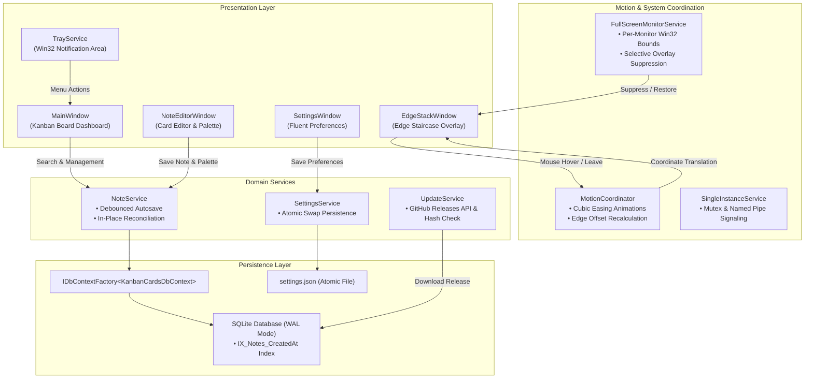

<div align="center">


# KanbanCards

### Notes that live on the edge.

A minimal, bezel-docked sticky note system for Windows.<br/>
Collapsed into a subtle staircase until you need it, fluid when you touch it, invisible when you game.

<br/>

[](https://microsoft.com/windows)
[](https://dotnet.microsoft.com/)
[](https://github.com/dotnet/wpf)
[](https://sqlite.org/)
[](https://github.com/danycli/KanbanCards/releases/latest)
[](LICENSE)

<br/>

[**Download Installer (v1.3.0)**](https://github.com/danycli/KanbanCards/releases/latest) &nbsp;&bull;&nbsp; [The Experience](#the-experience) &nbsp;&bull;&nbsp; [Product Features](#product-features) &nbsp;&bull;&nbsp; [Color System](#color-system) &nbsp;&bull;&nbsp; [Engineering](#engineering-highlights) &nbsp;&bull;&nbsp; [Shortcuts](#keyboard-shortcuts) &nbsp;&bull;&nbsp; [Architecture](#system-architecture)

---

</div>

## The Experience

Traditional sticky notes take up prime screen real estate, get trapped behind browser windows, and demand constant rearranging.

**KanbanCards** re-engineers note-taking for focus:

- **Tucked Into the Bezel**: Notes rest collapsed against the edge of your screen in an orderly, vertical staircase. Only subtle pastel tabs peek out.
- **Glanceable on Hover**: Moving your cursor to the screen edge smoothly glides the cards out with cubic-bezier easing. Read your thoughts, click to edit, or capture a quick task—without stealing window focus from what you're working on.
- **Out of Your Way When It Counts**: When you launch a fullscreen game, presentation, or movie, KanbanCards detects the foreground window bounds and hides automatically.
- **A Full Board When Needed**: Whenever you need a wider view, the Kanban Board provides instantaneous, debounced search across titles and content, complete with relative timestamps.

<br/>

```
      DESKTOP WORKSPACE (100% CLEAR)              SCREEN BEZEL
 ┌───────────────────────────────────────────────┬────────────┐
 │                                               │ [Soft Sky] │
 │                                               │ [Butter]   │ ◄── Subtle
 │             Active Browser Window             │ [Mint]     │     collapsed
 │                 or IDE Code                   │ [Blush]    │     staircase
 │                                               │ [Lavender] │     stack
 │                                               │ [+]        │
 └───────────────────────────────────────────────┴────────────┘
```

> **Visual Preview Note**: *Direct GUI screenshots are being staged for the upcoming media gallery release. Experience the live staircase motion directly by downloading the lightweight [v1.3.0 installer](https://github.com/danycli/KanbanCards/releases/latest).*

---

## Why KanbanCards?

| Workflow Aspect | Traditional Sticky Notes | KanbanCards |
| :--- | :--- | :--- |
| **Screen Real Estate** | Scatter across open windows and obscure documents | Rest flush against screen bezel in a collapsed staircase |
| **Hover Interaction** | Must click taskbar or manually hunt for windows | Smooth cubic expansion on hover; instant auto-retract |
| **Fullscreen Games & Media** | Interrupt gameplay or pop over presentation slides | Per-monitor Win32 detection suppresses stack automatically |
| **Multi-Monitor Behavior** | Often drift between monitors on disconnect | Anchors to configured primary bezel; ignores other displays |
| **Search & Organization** | Clunky manual inspection or slow scan | 150ms debounced live search backed by SQLite indexes |
| **Data Safety & Integrity** | High risk of file-lock collision during autosave | SQLite WAL mode + isolated `IDbContextFactory` operations |
| **Installation & Updates** | Bulky multi-step MSI setups with admin prompts | Zero-UAC per-user setup with silent background auto-updates |

---

## Product Features

### Edge-Docked by Design
Your notes stay anchored to either the **Right** or **Left** screen bezel. The card staircase calculates its geometry relative to the active work area, dynamically inverting rounded corners, hit-test zones, and slide-in transforms so that the stack looks native regardless of your display layout.

### Motion That Feels Natural
Card expansion is powered by hardware-accelerated WPF storyboards utilizing custom cubic-bezier curves (`EaseInOutCubic`). The motion is snappy enough to feel instant, yet soft enough to preserve visual continuity. Moving the cursor away retracts the staircase cleanly into the bezel margin.

### Your Workspace Stays Yours
KanbanCards runs a dedicated Win32 monitor service that continuously tracks the active foreground window. If a borderless or exclusive fullscreen application is running (such as a game, video player, or slide deck), the edge overlay temporarily hides itself. Because detection is **per-monitor aware**, fullscreen content on Monitor 2 will never hide your notes on Monitor 1.

### A Board When You Need One
When you want to organize tasks or search past ideas, open the companion **Kanban Board**. It features:
- **Debounced Search**: Filter through note titles and markdown content with a 150ms debounce window.
- **In-Place Reconciliation**: Modifying a note updates the collection in-place without jarring scroll resets or UI flicker.
- **Relative Timestamps**: Cards display human-readable timestamps (*"Just now"*, *"2 hours ago"*, *"Yesterday"*).
- **Safety Confirmations**: Dedicated card-styled confirmation dialogs prevent accidental deletion.

### Notes Stay Safe & Resilient
Your notes are stored in a local SQLite database configured with **Write-Ahead Logging (WAL)**. Reads and writes never block each other. Every database call uses an isolated context lifetime from `IDbContextFactory`, preventing concurrency leaks and lingering entity tracking.

### Built for Windows, Not Around It
- **System Tray Lifecycle**: Lives quietly in the Windows notification area with clean Fluent-style glyphs.
- **Single-Instance Mutex**: Launching the app a second time signals the existing process to bring the main window to front without spawning duplicate processes.
- **Display & DPI Awareness**: Listens to Windows `WM_DPICHANGED` and display resolution events, automatically recalculating edge margins when monitors change.

---

## Color System

KanbanCards includes a six-tone pastel palette designed to be easy on the eyes during long desktop sessions:

| Palette Name | Accent | Card Background | Recommended Use |
| :--- | :---: | :---: | :--- |
| **Soft Sky** | `#2196F3` | `#E5F3FF` | Daily tasks, ongoing tracking, and reminders |
| **Butter Yellow** | `#FBC02D` | `#FFF9C4` | High-priority items, immediate deadlines |
| **Mint Green** | `#4CAF50` | `#E8F5E9` | Completed milestones, verified references |
| **Blush Red** | `#F44336` | `#FFEBEE` | Critical blockers, urgent bugs |
| **Lavender Purple** | `#9C27B0` | `#F3E5F5` | Architecture notes, brainstorms, research |
| **Warm Peach** | `#FF9800` | `#FFF3E0` | Scheduled follow-ups, meeting agendas |

In the note editor, color swatches are grouped with mutually exclusive radio indicators, updating the active note theme in real time across both the editor and the edge staircase.

---

## Engineering Highlights

Behind its minimalist interface, KanbanCards is engineered for reliability, responsiveness, and zero memory leaks:

- **.NET 8 & C# 12**: Leverages modern C# features, file-scoped namespaces, pattern matching, and native performance optimizations.
- **Entity Framework Core 8 with DbContextFactory**: Eliminates shared-state database bugs. Short-lived context instances are created on-demand for each asynchronous task and disposed immediately.
- **SQLite Write-Ahead Logging (WAL)**: Initialized with `PRAGMA journal_mode=WAL;`. Reads execute concurrently without waiting for write transactions to commit.
- **Index-Accelerated Retrieval**: Configured with a dedicated index (`CREATE INDEX IF NOT EXISTS IX_Notes_CreatedAt ON Notes(CreatedAt DESC)`), ensuring instant note sorting even as your archive grows.
- **Atomic Settings Persistence**: Preferences are serialized to a temporary swap file before being atomically replaced via file system operations, preventing corrupted `settings.json` during abrupt power cuts.
- **Win32 Monitor Boundary Math**: P/Invoke bindings to `GetForegroundWindow`, `GetWindowRect`, and `MonitorFromWindow` provide lightweight fullscreen checking with negligible CPU usage.
- **Automated Test Suite**: **94 unit and integration tests** verify motion geometry, debouncing logic, mutex signaling, and installer integrity on every build.

---

## Keyboard Shortcuts

| Shortcut | Scope | Function |
| :--- | :--- | :--- |
| <kbd>Ctrl</kbd> + <kbd>N</kbd> | Global / Board | Create a new sticky note |
| <kbd>Ctrl</kbd> + <kbd>F</kbd> | Main Board | Focus search field and select current query |
| <kbd>Enter</kbd> | Main Board | Open selected note in editor |
| <kbd>Delete</kbd> | Main Board | Prompt confirmation dialog to delete selected note |
| <kbd>Ctrl</kbd> + <kbd>Enter</kbd> | Note Editor | Save note and dismiss editor |
| <kbd>Esc</kbd> | Anywhere | Close dialogs, note editor, or settings window |

---

## System Architecture



---

## Installation

### Option 1: Modern Native Installer (Recommended)

1. Download **`KanbanCardsSetup.exe`** from the [Latest GitHub Release](https://github.com/danycli/KanbanCards/releases/latest).
2. Run the installer. It installs per-user into `%LocalAppData%\Programs\KanbanCards` with **zero UAC prompts**.
3. Launch **KanbanCards** directly from your Start Menu or Desktop shortcut.

#### Unattended & Silent Deployments

The installer supports standard command-line flags:

```powershell
# Silent install without prompts
.\KanbanCardsSetup.exe /SILENT /NORESTART

# Custom install path
.\KanbanCardsSetup.exe /DIR="D:\Tools\KanbanCards"
```

To uninstall, run `uninstall.exe` in the application directory. All application files and shortcuts are removed cleanly, while your personal note database in `%LocalAppData%\KanbanCards` is preserved.

---

### Option 2: Build from Source

#### Prerequisites
- Windows 10 or 11 (64-bit)
- [.NET 8.0 SDK](https://dotnet.microsoft.com/download/dotnet/8.0)
- Git

```powershell
# 1. Clone the repository
git clone https://github.com/danycli/KanbanCards.git
cd KanbanCards

# 2. Run automated test suite (94 tests)
dotnet test tests/KanbanCards.Tests/KanbanCards.Tests.csproj

# 3. Launch application locally
dotnet run --project KanbanCards.csproj
```

#### Packaging the Installer

To compile the self-contained native installer bundle:

```powershell
powershell -ExecutionPolicy Bypass -File .\Installer\build.ps1
```

The compiled installer will be output to `Installer\Output\KanbanCardsSetup.exe` alongside its SHA-256 checksum.

---

## Automated Test Suite

KanbanCards includes a comprehensive test suite of **94 unit and integration tests** covering:

- **Geometry & Coordinate Math**: Verifies staircase calculations, edge hit-testing, and dynamic bezel anchoring.
- **Search & Debouncing**: Ensures search filtering, relative timestamp formatting, and title extraction.
- **Single-Instance Mutex**: Validates cross-process signaling and duplicate launch suppression.
- **Multi-Monitor Fullscreen Detection**: Emulates secondary-monitor fullscreen states and edge-stack safety.
- **Database Concurrency**: Tests parallel operations against `IDbContextFactory` under SQLite WAL mode.
- **Installer Lifecycle**: Validates payload archive decompression, shortcut generation, uninstall registry registration, and data preservation.

```powershell
dotnet test tests/KanbanCards.Tests/KanbanCards.Tests.csproj --logger "console;verbosity=normal"
```

---

## Tech Stack

| Layer | Technology | Purpose |
| :--- | :--- | :--- |
| **Runtime** | [.NET 8.0](https://dotnet.microsoft.com/) / C# 12 | Core execution engine, memory management, and asynchronous I/O |
| **UI Framework** | [WPF](https://github.com/dotnet/wpf) (XAML) | Hardware-accelerated desktop rendering, storyboards, and cubic easing |
| **Data Layer** | [Entity Framework Core 8](https://learn.microsoft.com/ef/core/) | Isolated `IDbContextFactory` database transactions and schema migrations |
| **Database** | [SQLite](https://www.sqlite.org/) | Embedded local storage configured with Write-Ahead Logging (WAL) |
| **System Tray** | [H.NotifyIcon.Wpf](https://github.com/HavenDV/H.NotifyIcon) | Win32 notification area integration and context menu lifecycle |
| **Testing** | [xUnit](https://xunit.net/) & [Moq](https://github.com/devlooped/moq) | Automated test suite validating architecture and domain behaviors |

---

## Contributing

Contributions, feedback, and ideas are welcome. To get involved:

1. Fork the repository.
2. Create your feature branch: `git checkout -b feature/my-feature`.
3. Commit your changes: `git commit -m 'feat: add my feature'`.
4. Push to your branch: `git push origin feature/my-feature`.
5. Open a Pull Request.

---

## License

KanbanCards is licensed under the [MIT License](LICENSE).

<br/>

<div align="center">

### A calmer workspace awaits.

If KanbanCards made your desktop a little less chaotic and your daily thoughts easier to reach,<br/>
consider leaving a star on GitHub. It helps this independent open-source project grow.

<br/>

[](https://github.com/danycli/KanbanCards)

<br/>

*Designed for focus. Built for Windows.*

</div>
