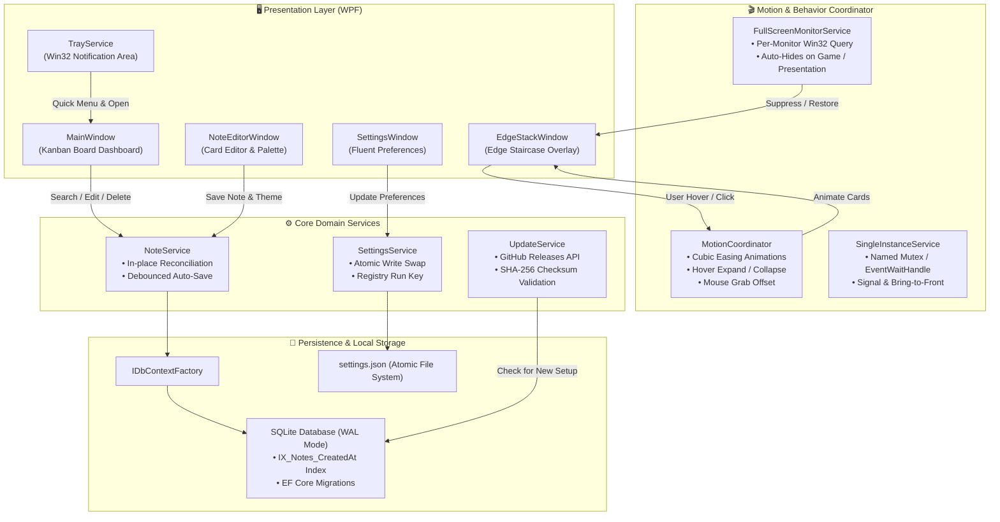

<div align="center">

# 🗂️ KanbanCards

### *The sleek, edge-docked sticky notes workspace for Windows.*

**Keep your thoughts, quick reminders, and daily sprints effortlessly organized along your screen bezels without cluttering your desktop.**

<br/>

[](https://microsoft.com/windows)
[](https://dotnet.microsoft.com/)
[](https://github.com/dotnet/wpf)
[](https://sqlite.org/)
[](https://github.com/danycli/KanbanCards/releases)
[](LICENSE)
[](https://github.com/danycli/KanbanCards/pulls)

<br/>

[**Download Latest Setup**](https://github.com/danycli/KanbanCards/releases/latest) • [**Explore Features**](#-features) • [**Keyboard Shortcuts**](#-keyboard-shortcuts) • [**Architecture**](#-technical-architecture) • [**Quick Start**](#-quick-start)

---

</div>

## 💡 Why KanbanCards?

Traditional sticky notes clutter your screen, cover open browser tabs, and get lost behind windows. **KanbanCards** re-imagines desktop productivity with a sleek **edge-docked staircase stack**:

| Traditional Sticky Notes | 🗂️ KanbanCards |
| :--- | :--- |
| ❌ Float chaotically across open work windows | ✅ **Tucks away into screen bezels** until hovered |
| ❌ Interrupt fullscreen games and media playback | ✅ **Smart multi-monitor fullscreen auto-suppression** |
| ❌ High risk of SQLite locks and write stalls | ✅ **EF Core DbContext Factory + SQLite WAL mode** |
| ❌ Slow, unindexed full database scans | ✅ **Instant debounced search with index-accelerated sorting** |
| ❌ Clunky legacy multi-page setup wizards | ✅ **Custom-tailored native card installer & uninstaller** |

---

## ✨ Features

### ⚡ **Edge-Docked Staircase Stack**
- **Dynamic Bezel Adaptation**: Dock seamlessly to either the **Left** or **Right** edge of your primary screen.
- **Fluid Hover Expansion**: Cards smoothly slide out with custom cubic-bezier easing (`EaseInOutCubic`), giving you instant glanceability without obscuring active work.
- **DPI & Resolution Resilience**: Real-time listening to Windows display setting and DPI scale changes ensures cards never get cut off or misplaced.

### 🖥️ **Smart Multi-Monitor & Fullscreen Shield**
- **Non-Intrusive Presence**: Uses native Win32 window-rect detection to detect true foreground fullscreen apps (e.g., games, presentation slides, video players).
- **Multi-Display Aware**: Only suppresses edge overlays if the fullscreen app is actually running on the same monitor as KanbanCards, leaving notes active across other screens!

### 🔍 **Instant Search & Kanban Board**
- **Debounced Live Filtering**: Search through titles and markdown content with a 150ms debounce window.
- **Zero-Flicker In-Place Reconciliation**: Modifying notes updates UI state directly without jarring scroll resets or full-collection rebuilds.
- **Relative Timestamps**: Human-friendly timestamps (*"Just now"*, *"2 hours ago"*, *"Yesterday"*).

### 🎨 **Vibrant Pastel Color Swatches**
- **6 Handpicked Colorways**: Assign Blue, Yellow, Green, Red, Purple, or Orange to visually organize projects, priorities, and sprints.
- **Synchronized Radio Palettes**: Mutually exclusive selection indicators reflect active note themes in real time across the editor and edge stack.

### 💾 **Resilient Local Persistence**
- **Entity Framework Core DbContext Factory**: High-concurrency database access using fresh, isolated context lifetimes to eliminate concurrency leaks.
- **SQLite Write-Ahead Logging (WAL)**: Concurrent reads never block writes; instant transactions with auto-flushing.
- **Indexed Sorting**: Native SQLite index (`IX_Notes_CreatedAt`) guarantees sub-millisecond retrieval on large note archives.
- **Atomic Settings Management**: Settings are serialized to temporary swapfiles and replaced atomically to eliminate corruption during power interruptions.

### 📦 **Bespoke Native Setup & Uninstaller**
- **Tailored Modern Card Experience**: Custom setup application styled identically to the app's minimalist aesthetic.
- **Per-User Zero-UAC Installation**: Fast installation directly into `%LocalAppData%` without requiring elevated administrative privileges.
- **Safe Data Retention**: Uninstalling cleanly removes binaries and shortcuts while safely leaving note databases intact in `%AppData%\KanbanCards`.

### 🔄 **GitHub Automated Updates**
- **Background Release Polling**: Periodically queries GitHub Releases API with automated exponential backoff and rate-limit awareness.
- **Integrity Validation**: Verifies both SHA-256 file hashes and digital signatures prior to executing update packages.
- **Seamless Silent Upgrade**: Updates install smoothly via command-line switches (`/SILENT /NORESTART`) without user disruption.

---

## ⌨️ Keyboard Shortcuts

Speed up your workflow with native hotkey support:

| Shortcut | Scope | Action |
| :--- | :--- | :--- |
| <kbd>Ctrl</kbd> + <kbd>N</kbd> | Global / Board | Create a new sticky note instantly |
| <kbd>Ctrl</kbd> + <kbd>F</kbd> | Main Board | Focus the search input and select existing query |
| <kbd>Enter</kbd> | Main Board | Open and edit the selected note |
| <kbd>Delete</kbd> | Main Board | Trigger confirmation dialog to delete selected note |
| <kbd>Ctrl</kbd> + <kbd>Enter</kbd> | Note Editor | Save changes and close the editor |
| <kbd>Esc</kbd> | Anywhere | Close dialogs, note editor, or settings menu |

---

## 🏗️ Technical Architecture

The following diagram illustrates how KanbanCards processes interactions, coordinates motion, and persists state across services:



---

## 🚀 Quick Start

### Option 1: Modern Native Installer (Recommended)

1. Grab the latest `KanbanCardsSetup.exe` from [**Releases**](https://github.com/danycli/KanbanCards/releases).
2. Run the executable — enjoy a clean, instant setup experience.
3. Launch **KanbanCards** from your Start Menu or Desktop.

### Option 2: Build from Source

#### Prerequisites
- Windows 10 or 11 (64-bit)
- [.NET 8.0 SDK](https://dotnet.microsoft.com/download/dotnet/8.0)
- Git

```powershell
# 1. Clone the repository
git clone https://github.com/danycli/KanbanCards.git
cd KanbanCards

# 2. Restore and run unit tests (94 tests)
dotnet test tests/KanbanCards.Tests/KanbanCards.Tests.csproj

# 3. Build and launch locally
dotnet run --project KanbanCards.csproj
```

#### Build the Native Installer

To package the self-contained installer (`KanbanCardsSetup.exe`):

```powershell
powershell -ExecutionPolicy Bypass -File .\build-installer.ps1
```
The compiled installer will be available at `Installer\Output\KanbanCardsSetup.exe`.

---

## 🧪 Comprehensive Test Suite

KanbanCards includes a high-standard automated test suite with **94 Unit & Integration Tests** covering:
- **Motion & Stack Geometry**: Verifies staircase positioning, mouse hit-testing, and dynamic bezel anchoring.
- **Search & Debouncing**: Ensures fast query filtering and relative time formatters.
- **Single Instance & Mutex**: Simulates duplicate launches, parameter signaling, and cross-process wakeup.
- **Multi-Monitor Fullscreen Detection**: Emulates secondary-monitor fullscreen states and edge-stack safety.
- **Update Engine Verification**: Validates semantic version parsing, SHA-256 signature checking, and quiet argument delegation.
- **Installer & Clean Uninstaller**: Validates payload zip extraction, shortcut creation, registry uninstaller registration, and data preservation.

```powershell
dotnet test tests/KanbanCards.Tests/KanbanCards.Tests.csproj --logger "console;verbosity=normal"
```

---

## 🛠️ Tech Stack & Dependencies

| Component | Technology | Purpose |
| :--- | :--- | :--- |
| **Runtime** | [.NET 8.0](https://dotnet.microsoft.com/) | Modern, high-performance C# managed runtime |
| **UI Framework** | [WPF (Windows Presentation Foundation)](https://github.com/dotnet/wpf) | Hardware-accelerated XAML interface and storyboard animations |
| **Data Layer** | [Entity Framework Core 8](https://learn.microsoft.com/ef/core/) | Object-relational mapping with isolated DbContext Factory |
| **Database** | [SQLite](https://www.sqlite.org/) | Embedded, fast local database with WAL concurrency mode |
| **System Tray** | [H.NotifyIcon.Wpf](https://github.com/HavenDV/H.NotifyIcon) | Win32 notification icon and context menu lifecycle |
| **Testing** | [xUnit](https://xunit.net/) & [Moq](https://github.com/devlooped/moq) | Rigorous unit and integration test coverage |

---

## 🤝 Contributing

Contributions make open-source an incredible place to learn, inspire, and create. Any contributions you make are **greatly appreciated**!

1. Fork the Project
2. Create your Feature Branch (`git checkout -b feature/AmazingFeature`)
3. Commit your Changes (`git commit -m 'feat: add some amazing feature'`)
4. Push to the Branch (`git push origin feature/AmazingFeature`)
5. Open a Pull Request

---

## 📄 License

Distributed under the **MIT License**. See [`LICENSE`](LICENSE) for more information.

---

<div align="center">

### ⭐ Star this Repository!
If KanbanCards helps keep your desktop organized and your workflow focused, please consider giving it a star! It helps more developers and creators discover the project.

<br/>

[](https://github.com/danycli/KanbanCards)

<br/>

*Crafted with care to keep your workspace distraction-free and your mind focused.*

</div>
