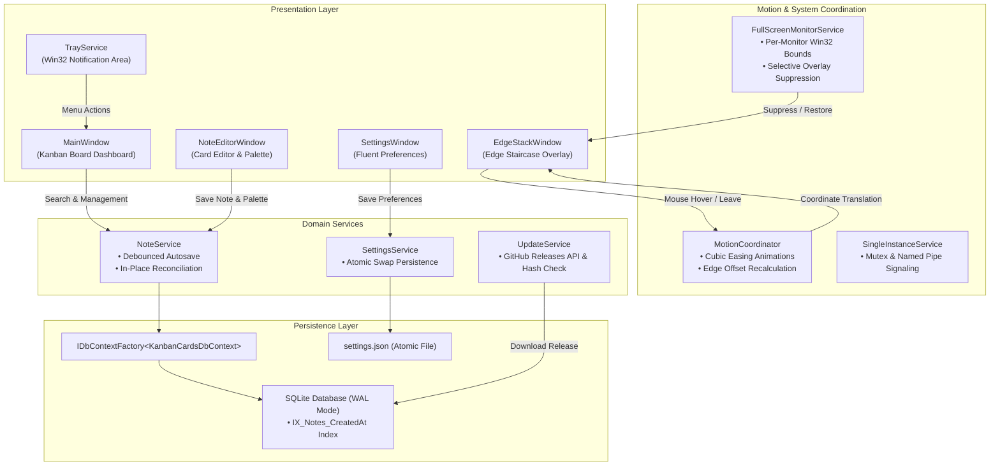

<div align="center">

# KanbanCards

**Modern, edge-docked workspace for Windows.**

An ultra-lightweight desktop sticky-note system that docks seamlessly along screen bezels. Built with .NET 8, WPF, and SQLite WAL for distraction-free note capture.

<br/>

[](https://microsoft.com/windows)
[](https://dotnet.microsoft.com/)
[](https://github.com/dotnet/wpf)
[](https://sqlite.org/)
[](https://github.com/danycli/KanbanCards/releases)
[](LICENSE)

<br/>

[Get Installer](#installation) &nbsp;•&nbsp; [Design Philosophy](#design-philosophy) &nbsp;•&nbsp; [Color System](#color-system) &nbsp;•&nbsp; [Engineering](#engineering-highlights) &nbsp;•&nbsp; [Shortcuts](#keyboard-shortcuts) &nbsp;•&nbsp; [Architecture](#system-architecture)

---

</div>

## Design Philosophy

Traditional desktop sticky notes clutter active monitors, get buried behind browser windows, and demand manual window management. 

KanbanCards rethinks note-taking through an **edge-docked staircase stack**:
- **Bezel Anchoring**: Notes rest collapsed against the screen edge, showing only subtle pastel indicators.
- **Fluid Inspection**: Hovering near the bezel smoothly expands the stack with cubic-bezier easing, exposing card titles and actions without stealing window focus.
- **Context Preservation**: Full-featured Kanban Board provides live search, editing, and organization whenever a wider view is needed.

### Workflow Comparison

| Capability | Traditional Sticky Notes | KanbanCards |
| :--- | :--- | :--- |
| **Desktop Presence** | Free-floating windows obscuring content | Collapsed edge staircase tucked against screen bezel |
| **Fullscreen Media / Games** | Popups interrupt games and videos | Automatic per-monitor Win32 fullscreen suppression |
| **Database Concurrency** | Prone to file locks during auto-save | SQLite WAL mode with isolated DbContext lifetimes |
| **Search Performance** | Slow full scans with UI freeze | 150ms debounced queries backed by SQLite index |
| **Installation Flow** | Multi-step legacy wizards requiring UAC | Per-user, zero-UAC modern card setup & uninstaller |

---

## Color System

KanbanCards utilizes a six-tone pastel palette designed to be easy on the eyes during prolonged desktop use:

| Palette Name | Accent | Card Tint | Recommended Use |
| :--- | :---: | :---: | :--- |
| **Soft Sky** | `#2196F3` | `#E5F3FF` | Daily tasks, ongoing tracking |
| **Butter Yellow** | `#FBC02D` | `#FFF9C4` | High-priority items, immediate focus |
| **Mint Green** | `#4CAF50` | `#E8F5E9` | Completed milestones, verified references |
| **Blush Red** | `#F44336` | `#FFEBEE` | Critical blockers, urgent deadlines |
| **Lavender Purple** | `#9C27B0` | `#F3E5F5` | Architecture notes, brainstorms, research |
| **Warm Peach** | `#FF9800` | `#FFF3E0` | Scheduled follow-ups, meeting agendas |

---

## Engineering Highlights

### Edge Stacking & Motion Coordination
- **Cubic Easing**: Stack expansion and retraction use custom cubic-bezier animations (`EaseInOutCubic`) for fluid physical response.
- **Dynamic Bezel Anchoring**: Cards can dock to either the Left or Right edge of the screen; corner radiuses, hit-test offsets, and translation transforms automatically invert to match the bezel.
- **Display Resolution & DPI Resilience**: Actively hooks into Windows display setting changes and DPI notifications (`WM_DPICHANGED`), dynamically recalculating work area geometry to prevent clipping or drift.

### Smart Fullscreen Suppression
- **Per-Monitor Win32 Query**: Checks foreground window bounds (`GetForegroundWindow`, `GetWindowRect`, `MonitorFromWindow`) to identify true borderless games or fullscreen video players.
- **Multi-Monitor Awareness**: If a game is fullscreen on Monitor 2, notes remain accessible on Monitor 1. KanbanCards only hides when the fullscreen application is on the exact display hosting the stack.

### Storage & Concurrency
- **SQLite Write-Ahead Logging (WAL)**: Configured with `PRAGMA journal_mode=WAL;`, enabling simultaneous reads and writes without contention or thread blocking.
- **Isolated DbContext Lifetimes**: Uses `IDbContextFactory<KanbanCardsDbContext>` to spawn isolated contexts per asynchronous operation, eliminating concurrency exceptions and entity tracking leaks.
- **Optimized Indexing**: Database schema enforces `IX_Notes_CreatedAt` index (`CREATE INDEX IF NOT EXISTS IX_Notes_CreatedAt ON Notes(CreatedAt DESC)`), accelerating time-based queries across thousands of notes.
- **Atomic Configuration Writes**: Application settings are serialized to a temporary file before being atomically swapped into `settings.json`, preventing data corruption during unexpected shutdowns.

### Search & In-Place Reconciliation
- **Debounced Input**: Search keystrokes are processed with a 150ms debouncing window to eliminate unnecessary database query churn.
- **Zero-Flicker Updates**: Modifying note content or themes updates existing bound collections in-place, preventing scroll position resets and UI stutter.

### Native Card Installer & Uninstaller
- **Filee-Inspired Experience**: Custom-crafted installer styled with the exact card visual aesthetic of the main application.
- **Zero UAC Requirement**: Installs per-user into `%LocalAppData%\Programs\KanbanCards`, bypassing administrator prompt barriers.
- **Safe Data Preservation**: Uninstaller cleanly purges application binaries and shortcuts while safeguarding note databases in `%LocalAppData%\KanbanCards`.

---

## Keyboard Shortcuts

| Shortcut | Scope | Function |
| :--- | :--- | :--- |
| <kbd>Ctrl</kbd> + <kbd>N</kbd> | Global / Board | Create a new note |
| <kbd>Ctrl</kbd> + <kbd>F</kbd> | Main Board | Focus search field and select current query |
| <kbd>Enter</kbd> | Main Board | Open selected note in editor |
| <kbd>Delete</kbd> | Main Board | Prompt confirmation dialog to delete selected note |
| <kbd>Ctrl</kbd> + <kbd>Enter</kbd> | Note Editor | Save note and dismiss editor |
| <kbd>Esc</kbd> | Anywhere | Close dialogs, note editor, or settings window |

---

## System Architecture



---

## Installation

### Method 1: Modern Native Installer (Recommended)

1. Download `KanbanCardsSetup.exe` from the [Latest Release](https://github.com/danycli/KanbanCards/releases/latest).
2. Run the installer. No administrative rights or UAC prompts are required.
3. Launch **KanbanCards** directly from your Start Menu or Desktop shortcut.

### Method 2: Building from Source

**Requirements:**
- Windows 10 or 11 (64-bit)
- [.NET 8.0 SDK](https://dotnet.microsoft.com/download/dotnet/8.0)
- Git

```powershell
# Clone repository
git clone https://github.com/danycli/KanbanCards.git
cd KanbanCards

# Run automated tests (94 unit & integration tests)
dotnet test tests/KanbanCards.Tests/KanbanCards.Tests.csproj

# Run application locally
dotnet run --project KanbanCards.csproj
```

**Compiling the Installer:**
```powershell
powershell -ExecutionPolicy Bypass -File .\build-installer.ps1
```
The compiled self-contained installer will be generated at `Installer\Output\KanbanCardsSetup.exe`.

---

## Automated Test Coverage

The project includes an automated test suite with **94 unit and integration tests** verifying:
- **Geometry & Coordinate Math**: Staircase positioning, edge hit-testing, and dynamic bezel anchoring.
- **Search & Debouncing**: Query filtering accuracy and relative date formatters.
- **Mutex & Single Instance**: Cross-process signaling and duplicate instance handling.
- **Multi-Monitor Fullscreen Detection**: Win32 window-rect calculations and monitor-specific suppression logic.
- **Database Concurrency**: Parallel operations against `IDbContextFactory` under SQLite WAL mode.
- **Installer Lifecycle**: Archive decompression, shortcut generation, uninstall registry registration, and data preservation.

```powershell
dotnet test tests/KanbanCards.Tests/KanbanCards.Tests.csproj --logger "console;verbosity=normal"
```

---

## Tech Stack

- **Framework**: .NET 8.0 (C# 12)
- **UI Platform**: Windows Presentation Foundation (WPF) with hardware-accelerated XAML
- **Data Access**: Entity Framework Core 8 with SQLite Provider
- **Concurrency Mode**: SQLite Write-Ahead Logging (WAL)
- **System Tray**: H.NotifyIcon.Wpf
- **Testing**: xUnit, Moq, Microsoft.EntityFrameworkCore.InMemory

---

## Contributing

Contributions and feedback are welcome. To contribute:

1. Fork the repository.
2. Create a feature branch: `git checkout -b feature/my-feature`.
3. Commit your changes: `git commit -m 'feat: add my feature'`.
4. Push to your branch: `git push origin feature/my-feature`.
5. Submit a Pull Request.

---

## License

This project is licensed under the **MIT License**. See the [LICENSE](LICENSE) file for complete terms.

<br/>

<div align="center">

**Enjoying KanbanCards?** Please star this repository on GitHub to support ongoing development.

[](https://github.com/danycli/KanbanCards)

</div>
