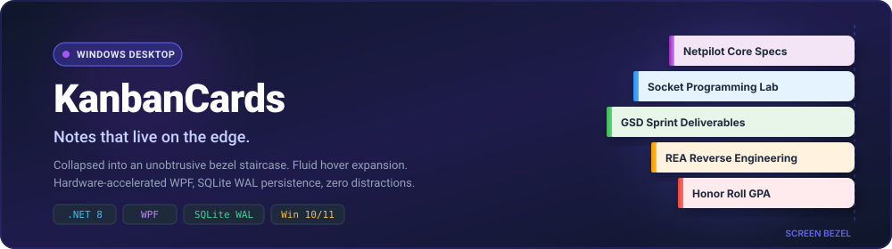
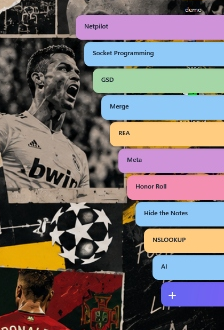
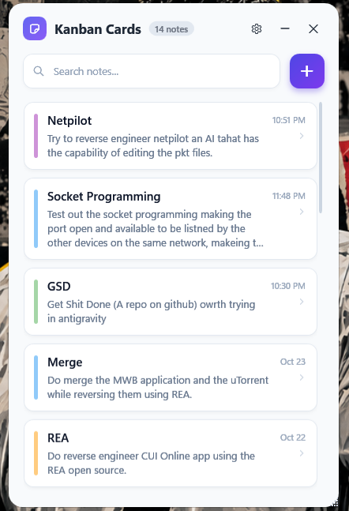
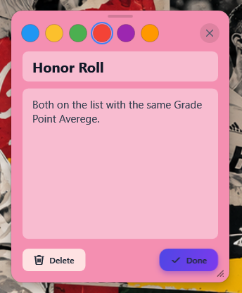
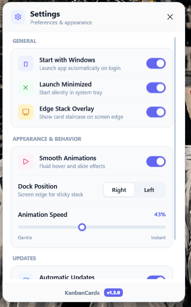
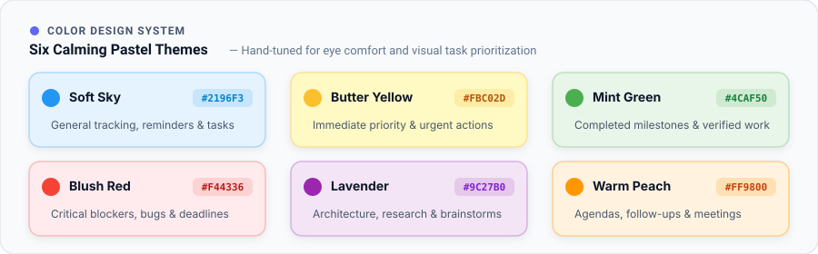
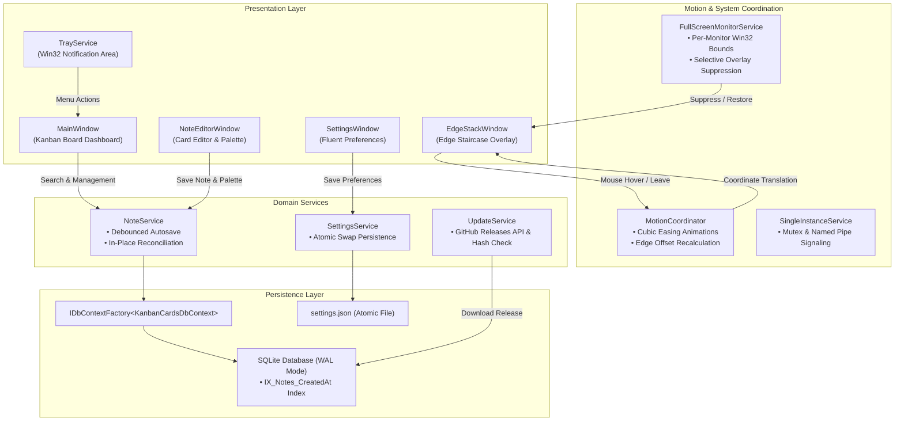

<div align="center">

<a href="https://github.com/danycli/KanbanCards">
  
</a>

<br/><br/>


# KanbanCards

### Notes that live on the edge.

**A minimal, bezel-docked sticky note system for Windows.**<br/>
Collapsed into an orderly staircase until you need it, fluid when you touch it, invisible when you game.

<br/>

[](https://microsoft.com/windows)
[](https://dotnet.microsoft.com/)
[](https://github.com/dotnet/wpf)
[](https://sqlite.org/)
[](https://github.com/danycli/KanbanCards/releases/latest)
[](tests/KanbanCards.Tests)
[](LICENSE)

<br/>

[**Download v1.3.0 Setup**](https://github.com/danycli/KanbanCards/releases/latest) &nbsp;&bull;&nbsp; [The Visual Experience](#the-visual-experience) &nbsp;&bull;&nbsp; [Bento Showcase](#bento-product-showcase) &nbsp;&bull;&nbsp; [Color System](#color-design-system) &nbsp;&bull;&nbsp; [Engineering](#engineering-highlights) &nbsp;&bull;&nbsp; [Shortcuts](#keyboard-shortcuts) &nbsp;&bull;&nbsp; [Architecture](#system-architecture)

---

</div>

## The Visual Experience

Traditional sticky notes clutter your workspace, get buried behind browser tabs, and demand constant window management. **KanbanCards** rethinks note capture from the ground up: cards rest flush against your screen bezel, expanding with smooth cubic-bezier motion only when hovered.

### 01. Notes That Live on the Edge

<table>
  <tr>
    <th width="50%" align="center">Collapsed in Screen Bezel (Zero Distractions)</th>
    <th width="50%" align="center">Expanded on Hover (Instant Glance &amp; Capture)</th>
  </tr>
  <tr>
    <td align="center" valign="top">
      <a href="assets/readme/edge-stack-collapsed.jpg">
        
      </a>
      <p align="left"><sub><b>Resting State:</b> Notes collapse flush against the right screen bezel. Subtle pastel tabs remain visible without covering open IDEs, browser tabs, or documents.</sub></p>
    </td>
    <td align="center" valign="top">
      <a href="assets/readme/edge-stack-expanded.jpg">
        
      </a>
      <p align="left"><sub><b>Expanded State:</b> Hovering near the bezel glides the staircase open with hardware-accelerated cubic easing. Read, click to edit, or add a card via the bottom <b><code>+</code></b> button.</sub></p>
    </td>
  </tr>
</table>

<br/>

### 02. Hover. Expand. Capture.

<table>
  <tr>
    <td width="30%" align="center" valign="middle">
      
    </td>
    <td width="70%" align="left" valign="middle">
      <h3>The Staircase Stack Anatomy</h3>
      <p>Each card in the edge overlay is color-coded and offset along a gentle staircase curve:</p>
      <ul>
        <li><b>Dynamic Bezel Anchoring</b>: Can be docked to either the <b>Right</b> or <b>Left</b> edge. Corner radiuses, hit-test zones, and slide-in transforms automatically invert to match the bezel.</li>
        <li><b>Cubic Easing Physics</b>: Powered by <code>EaseInOutCubic</code> storyboards for physical smoothness without feeling sluggish.</li>
        <li><b>Non-Stealing Focus</b>: Hovering and expanding does not steal focus from your active keyboard workflow.</li>
        <li><b>Instant Creation</b>: The persistent <b><code>+</code></b> card at the base of the staircase provides one-click note creation.</li>
      </ul>
    </td>
  </tr>
</table>

---

## Bento Product Showcase

Explore the three core pillars of KanbanCards: the comprehensive Kanban Board, the distraction-free Card Editor, and the Fluent Preferences system.

<table>
  <tr>
    <td width="55%" align="center" valign="top">
      <br/>
      <span style="font-size: 14px; font-weight: 700; color: #6366F1;">03. YOUR WORKSPACE, ORGANIZED</span>
      <h3>The Companion Kanban Board</h3>
      <p align="left">Whenever you need a broader perspective across your thoughts, open the main Kanban Cards board. Features real-time 150ms debounced search, relative timestamps (<i>"10:51 PM"</i>, <i>"Oct 23"</i>), and instant color indicators.</p>
      <a href="assets/readme/main-board.png">
        
      </a>
      <br/><br/>
    </td>
    <td width="45%" align="center" valign="top">
      <br/>
      <span style="font-size: 14px; font-weight: 700; color: #EC4899;">04. DISTRACTION-FREE EDITING</span>
      <h3>Frameless Note Editor</h3>
      <p align="left">Floating, draggable card editor with non-colliding radio swatches and clean typography.</p>
      <a href="assets/readme/note-editor.png">
        
      </a>
      <br/><br/>
      <span style="font-size: 14px; font-weight: 700; color: #3B82F6;">05. PREFERENCES &amp; BEHAVIOR</span>
      <h3>Fluent Settings Modal</h3>
      <p align="left">Adjust animation speed, switch docking edges (Right/Left), and manage tray behaviors.</p>
      <a href="assets/readme/settings.png">
        
      </a>
      <br/><br/>
    </td>
  </tr>
</table>

---

## Color Design System

Notes are organized using six hand-selected pastel palettes tuned for visual clarity and prolonged eye comfort:

<div align="center">
  
</div>

<br/>

| Palette Name | Accent Hex | Tint Hex | Recommended Context |
| :--- | :---: | :---: | :--- |
| **Soft Sky** | `#2196F3` | `#E5F3FF` | General reminders, daily task tracking, ongoing sprints |
| **Butter Yellow** | `#FBC02D` | `#FFF9C4` | High-priority immediate tasks, urgent actions |
| **Mint Green** | `#4CAF50` | `#E8F5E9` | Completed milestones, verified references, documentation |
| **Blush Red** | `#F44336` | `#FFEBEE` | Critical blockers, bug investigations, hard deadlines |
| **Lavender** | `#9C27B0` | `#F3E5F5` | Architecture notes, brainstorms, deep research |
| **Warm Peach** | `#FF9800` | `#FFF3E0` | Scheduled follow-ups, agendas, meeting points |

*In the Note Editor, color swatches are grouped with mutually exclusive radio indicators, updating the active theme in real time across both the editor and the edge staircase.*

---

## Engineering Highlights

Behind its gentle pastel aesthetic, KanbanCards is engineered for high performance, rock-solid persistence, and zero desktop interference:

<table>
  <tr>
    <td width="50%" valign="top">
      <h4>⚡ SQLite Write-Ahead Logging (WAL)</h4>
      <p>Configured with <code>PRAGMA journal_mode=WAL;</code>. Concurrent reads and writes execute without contention, ensuring background autosaving never blocks UI threads.</p>
    </td>
    <td width="50%" valign="top">
      <h4>🛡️ Per-Monitor Fullscreen Detection</h4>
      <p>Win32 P/Invoke queries (<code>GetForegroundWindow</code>, <code>GetWindowRect</code>, <code>MonitorFromWindow</code>) detect borderless games and presentations, suppressing the stack only on the display where the game is active.</p>
    </td>
  </tr>
  <tr>
    <td width="50%" valign="top">
      <h4>🔄 Isolated DbContext Factory</h4>
      <p>Uses <code>IDbContextFactory&lt;KanbanCardsDbContext&gt;</code> to spin up short-lived database contexts per operation, eliminating concurrency leaks and memory bloat.</p>
    </td>
    <td width="50%" valign="top">
      <h4>💾 Atomic Settings Persistence</h4>
      <p>Application preferences are serialized to a temporary swap file before an atomic file-system replacement, eliminating the risk of corrupted <code>settings.json</code> during power loss.</p>
    </td>
  </tr>
  <tr>
    <td width="50%" valign="top">
      <h4>🔍 150ms Debounced In-Place Filtering</h4>
      <p>Live search queries are debounced to prevent unnecessary database churn. Bound collections reconcile in-place, preserving scroll position without flicker.</p>
    </td>
    <td width="50%" valign="top">
      <h4>🧪 94 Automated Tests</h4>
      <p>A rigorous automated suite validates geometry math, mutex cross-process signaling, search filtering, and installer integrity on every build.</p>
    </td>
  </tr>
</table>

---

## Keyboard Shortcuts

| Shortcut | Scope | Function |
| :--- | :--- | :--- |
| <kbd>Ctrl</kbd> + <kbd>N</kbd> | Global / Board | Create a new sticky note |
| <kbd>Ctrl</kbd> + <kbd>F</kbd> | Main Board | Focus search input and select existing query |
| <kbd>Enter</kbd> | Main Board | Open selected note in editor |
| <kbd>Delete</kbd> | Main Board | Prompt confirmation dialog to delete selected note |
| <kbd>Ctrl</kbd> + <kbd>Enter</kbd> | Note Editor | Save note and dismiss editor |
| <kbd>Esc</kbd> | Anywhere | Close dialogs, note editor, or settings window |

---

## System Architecture



---

## Installation

### Method 1: Modern Native Installer (Recommended)

1. Download **`KanbanCardsSetup.exe`** from the [Latest GitHub Release](https://github.com/danycli/KanbanCards/releases/latest).
2. Run the executable. It installs per-user into `%LocalAppData%\Programs\KanbanCards` with **zero UAC prompts**.
3. Launch **KanbanCards** directly from your Start Menu or Desktop shortcut.

#### Unattended & Silent Deployments

```powershell
# Silent unattended installation
.\KanbanCardsSetup.exe /SILENT /NORESTART

# Custom installation target directory
.\KanbanCardsSetup.exe /DIR="D:\Tools\KanbanCards"
```

*To uninstall, run `uninstall.exe` in the application directory. All application binaries and shortcuts are removed cleanly, while your personal note database in `%LocalAppData%\KanbanCards` is safely preserved.*

---

### Method 2: Build from Source

#### Prerequisites
- Windows 10 or 11 (64-bit)
- [.NET 8.0 SDK](https://dotnet.microsoft.com/download/dotnet/8.0)
- Git

```powershell
# 1. Clone repository
git clone https://github.com/danycli/KanbanCards.git
cd KanbanCards

# 2. Run automated test suite (94 tests)
dotnet test tests/KanbanCards.Tests/KanbanCards.Tests.csproj

# 3. Launch application locally
dotnet run --project KanbanCards.csproj
```

#### Compiling the Installer Bundle

To package the self-contained native installer executable:

```powershell
powershell -ExecutionPolicy Bypass -File .\Installer\build.ps1
```

The compiled setup executable and its SHA-256 hash will be generated at `Installer\Output\KanbanCardsSetup.exe`.

---

## Automated Test Suite

KanbanCards includes **94 unit and integration tests** verifying:

- **Staircase Geometry Math**: Validates card coordinates, mouse hit-testing, and dynamic bezel anchoring.
- **Search & Debouncing**: Tests debounced filtering, relative timestamp formatting, and title extraction.
- **Single-Instance Mutex**: Validates cross-process signaling, wakeup handlers, and duplicate launch prevention.
- **Multi-Monitor Fullscreen Detection**: Emulates secondary-monitor fullscreen states and edge-stack safety.
- **Database Concurrency**: Tests parallel operations against `IDbContextFactory` under SQLite WAL mode.
- **Installer Lifecycle**: Validates archive decompression, shortcut generation, uninstall registry registration, and data preservation.

```powershell
dotnet test tests/KanbanCards.Tests/KanbanCards.Tests.csproj --logger "console;verbosity=normal"
```

---

## Tech Stack

| Layer | Technology | Purpose |
| :--- | :--- | :--- |
| **Runtime** | [.NET 8.0](https://dotnet.microsoft.com/) / C# 12 | Core execution engine, memory management, and asynchronous I/O |
| **UI Framework** | [WPF](https://github.com/dotnet/wpf) (XAML) | Hardware-accelerated desktop rendering, storyboards, and cubic easing |
| **Data Layer** | [Entity Framework Core 8](https://learn.microsoft.com/ef/core/) | Isolated `IDbContextFactory` transactions and schema migrations |
| **Database** | [SQLite](https://www.sqlite.org/) | Embedded local storage configured with Write-Ahead Logging (WAL) |
| **System Tray** | [H.NotifyIcon.Wpf](https://github.com/HavenDV/H.NotifyIcon) | Win32 notification area integration and context menu lifecycle |
| **Testing** | [xUnit](https://xunit.net/) & [Moq](https://github.com/devlooped/moq) | Automated test suite validating architecture and domain behaviors |

---

## Contributing

Contributions, feedback, and ideas are welcome. To get involved:

1. Fork the repository.
2. Create your feature branch: `git checkout -b feature/my-feature`.
3. Commit your changes: `git commit -m 'feat: add my feature'`.
4. Push to your branch: `git push origin feature/my-feature`.
5. Open a Pull Request.

---

## License

KanbanCards is open-source software licensed under the [MIT License](LICENSE).

<br/>

<div align="center">

<a href="https://github.com/danycli/KanbanCards">
  
</a>

<br/><br/>

[](https://github.com/danycli/KanbanCards)

<br/>

*Designed for focus. Built for Windows.*

</div>
